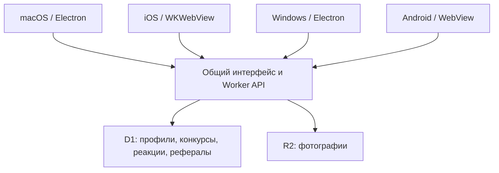

# Архитектура Tune Arena 1.0.0

Автор: Vadym Tsinderhoz. Дата: 7 ноября 2026.

Четыре клиента показывают одну версию интерфейса с одного сервера. Они не вычисляют победителя и не выдают себе Премиум. Решения принимаются сервером и ограничениями базы. Собственный UI и бизнес-логика полностью находятся в `web/`; native-клиенты обеспечивают окно приложения, доступ к камере/файлам, постоянный сеанс и настройки подключения.

## Реакции и итог

В `votes` одна строка на пару работа/пользователь. Значение `1` — лайк, `-1` — дизлайк. Переключение обновляет ту же строку. Повторное нажатие снимает соответствующую реакцию; запоздалое снятие лайка не снимает более новый дизлайк. После срока раунда изменения запрещены. В итог идут только лайки за видимые работы внутри временного окна. При равенстве действует порядок принятия работы; без лайков победителя нет.

Комментарии полностью отключены в интерфейсе и API. Историческая таблица сохранена в миграциях для совместимости с существующими данными, но приложение её не выдаёт.

## Фото

Выбор файла либо камера → локальный предпросмотр → декодирование и JPEG до 2048 px → явное нажатие публикации → проверка типа/размера сервером → R2 и запись работы в D1. Камера выключается при закрытии/выборе/уходе из формы. Снимок не доказывает, когда и где он был сделан. Сеть нужна только для публикации и данных конкурса.

## Рефералы

Персональная ссылка хранит непрозрачный код. Новый профиль получает 3 дня Премиума один раз. Для активности нужен никнейм и 1 реальная работа в общем конкурсе либо 10 сохранённых лайков разным реальным работам. Дизлайки, собственные работы, работы пригласившего, примеры и тестовые раунды не учитываются. За каждую тройку — 30 дней. Транзакционные записи начисленных групп защищают от повторной выдачи при повторных запросах. Это проверка активности, а не доказательство уникальности людей.

## Развёртывания

Публичный размещённый сервер и локальная база — разные экземпляры. Репозиторий не содержит пользовательских данных сервера. Все клиенты должны указывать на один выбранный сервер для общего конкурса. Обновление web-интерфейса распространяется с сервера; native-изменения требуют новой сборки клиента.

PWA использует ту же серверную систему. `/install` содержит инструкции и Android test APK. Manifest объявляет standalone-режим; service worker сохраняет только публичные offline-справку и иконки. API, аккаунт, голоса, фотографии, админка и ссылки подтверждения не кешируются и не ставятся в офлайн-очередь.
